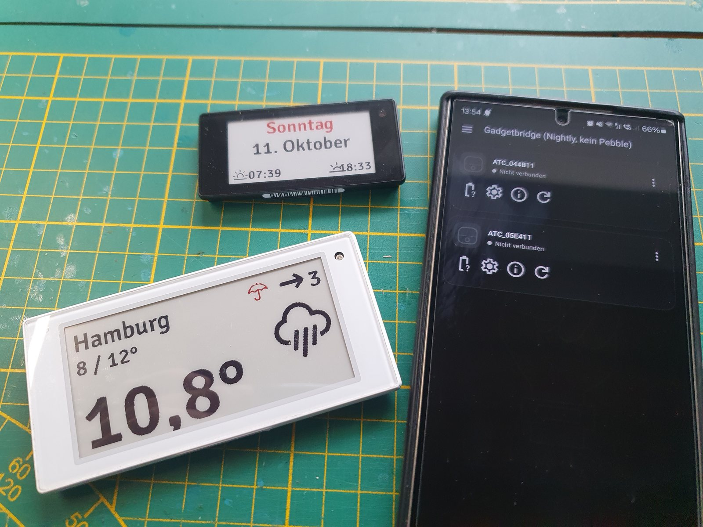
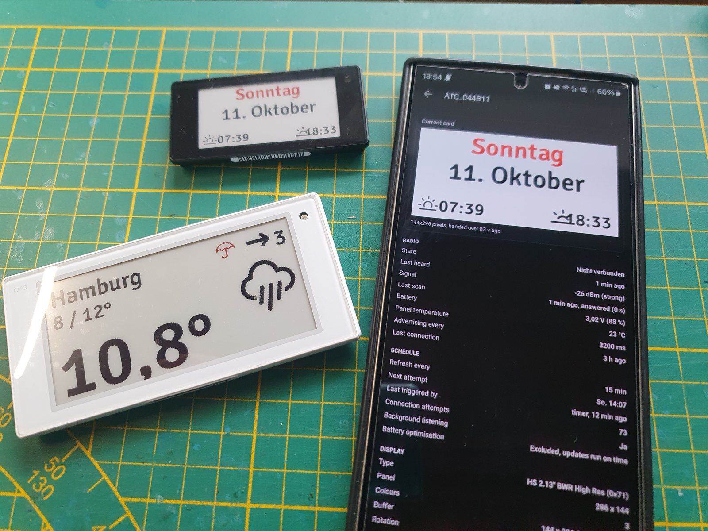
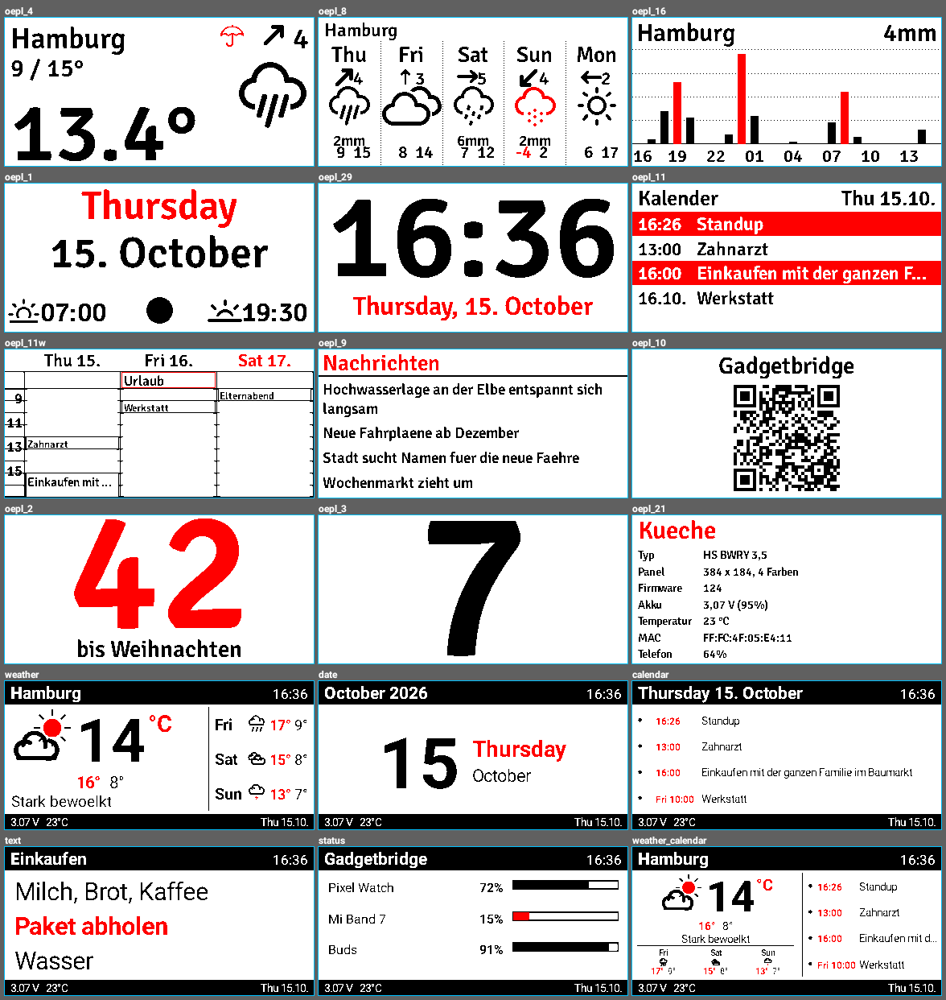
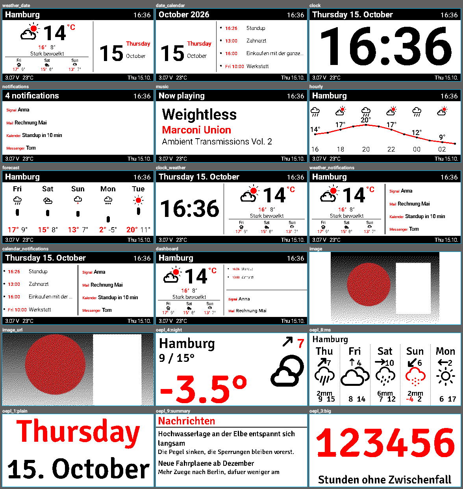
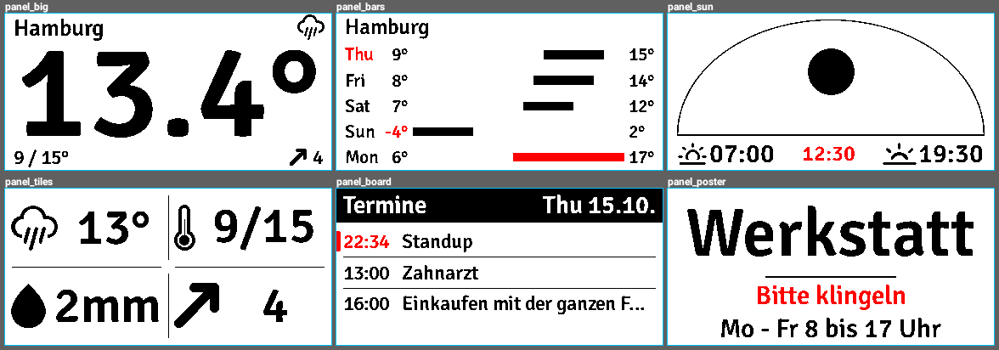
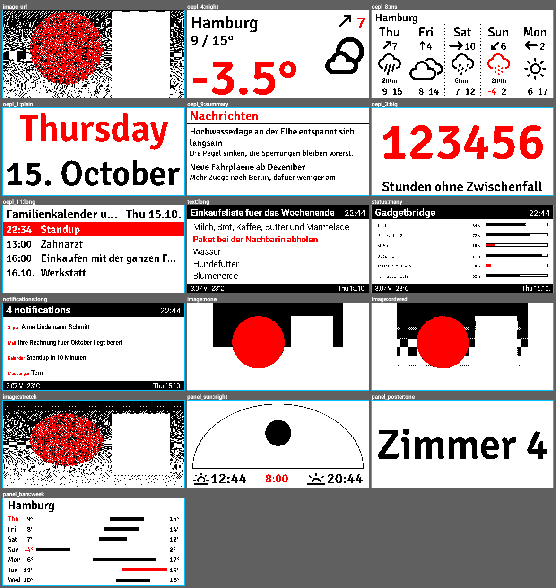

# Gadgetbridge BLE OpenEPaperLink

A fork of [Gadgetbridge](https://codeberg.org/Freeyourgadget/Gadgetbridge) that turns a BLE
electronic shelf label running the **ATC_BLE_OEPL** firmware into a weather display, driven by
the phone alone — no access point, no server, no account.

The phone fetches the forecast, draws the card, and pushes it to the tag over Bluetooth LE
whenever there is something new to show. Everything an OpenEPaperLink access point would
normally do happens on the phone.



## What it adds

A new device type, **OEPL Weather Display**, alongside the existing ATC_BLE_OEPL support:

- **37 card designs.** Twelve in the style of the OpenEPaperLink layouts (current weather,
  forecast, rain graph, date, clock, appointments, week view, news feed, QR code, two
  countdowns, display info), six of this project's own that take the whole panel (the
  temperature at poster size, the week as bars, the sun's day as a diagram, today in tiles, an
  appointment board, your own text as a poster), seventeen drawn inside a Gadgetbridge frame
  (weather, calendar, notifications, music, temperature curve, dashboard …), and two picture
  cards.
- **Pictures.** A photo from the phone or an image from a URL, reduced to the colours the panel
  really has — with error diffusion, an ordered pattern, or no dithering at all, previewed
  before it is sent.
- **A visual design picker.** Every design drawn with your own data, at your panel's size and
  in your panel's colours. Tap one and it goes onto the tag.
- **Weather without an account.** [Open-Meteo](https://open-meteo.com) is fetched directly, or
  Gadgetbridge's own weather is used if you prefer.
- **Updates that actually arrive.** Exact alarms instead of deferrable background work, a
  connection window long enough for a tag that advertises every few seconds, several attempts
  per update, a wake lock held across the transfer, and an opportunistic background scan that
  pushes an overdue picture the moment the tag is heard.
- **A status page per display.** Signal, panel type, battery, temperature, what the last
  transfer cost and how long it took, when the next attempt is due — and a preview of the card
  the tag is showing right now, which is also used as the device's icon in the device list.
- **Compressed transfers.** The picture goes out as raw deflate with periodic flushes, the way
  the firmware expects it; a 384×184 four colour card is around 2 kB instead of 17 kB.



### The designs

Drawn at 384×184, the panel this was developed against. Every design is laid out from measured
text rather than fixed pixel offsets, so the same card holds together on a 152×152 price tag and
on a 960×768 panel.




The six that are this project's own rather than a version of an OpenEPaperLink layout — their
ids begin with `panel_`, and each goes in a different direction: one figure read from across the
room, a chart, a diagram, tiles, a board, and type:



The three ways a picture can be reduced to the panel's colours, bottom row:



## Install

Grab the APK from the [latest release](../../releases/latest) and install it.

It is built from the `mainlineNopebble` flavour, so its application id is
`nodomain.freeyourgadget.gadgetbridge.nightly_nopebble` and it installs **alongside** a normal
Gadgetbridge rather than replacing it. The app shows up as *Gadgetbridge OEPL*.

> **Updating:** every release is signed with the same key, so a new APK installs over the one
> already on the phone. Releases built before October 2026 used a throwaway debug key, so going
> from one of those to a current build needs the old app uninstalled once. See
> [docs/releases.md](docs/releases.md).

### Setting a display up

1. Flash [ATC_BLE_OEPL](https://gadgetbridge.org/gadgets/displays/atc_ble_oepl/) onto the tag.
2. In the app, search for devices and pick the one named `ATC_…`. Choose **OEPL Weather
   Display** when asked which kind it is (long press the entry to force the type if the plain
   ATC_BLE_OEPL entry was picked).
3. Open the device settings, choose a design, set your location, and let it connect once.
4. Exclude the app from battery optimisation — there is a button for it on the device's status
   page. Android is otherwise free to hold the update alarms back.

## Build

JDK 21 and the Android SDK (compileSdk 37) are what the upstream project needs:

```sh
./gradlew assembleMainlineNopebble
# app/build/outputs/apk/mainline/nopebble/*.apk
```

Unit tests, including the ones that draw every design and check that nothing overlaps or runs
off the panel:

```sh
./gradlew testMainlineDebugUnitTest --tests '*OEPL*' --tests '*Oepl*'
```

The drawing tests write contact sheets of every design, at six panel shapes, to
`app/build/oepl-gallery/` — which is where the pictures above come from. If you change a layout,
look at them.

Alongside them runs an audit that draws every design on **every panel geometry in the tag
catalogue, in both orientations** — 52 designs across 77 shapes, four thousand cards — and
fails on two things a layout written for one panel keeps doing on another: ink outside the area
the card was given, and two pieces of text in the same place. It works on the boxes the glyphs
really cover, so it sees a collision that a pixel count cannot, and its report is written to
`app/build/oepl-gallery/layout-audit.txt`.

## Documentation

- [docs/oepl-weather-display.md](docs/oepl-weather-display.md) — what the device does, every
  setting, the card catalogue, the protocol and how to add a card of your own.
- [docs/releases.md](docs/releases.md) — how the automatic release build works and how it is
  signed.
- [CREDITS.md](CREDITS.md) — who made the pieces this is built on.
- [README-Gadgetbridge.md](README-Gadgetbridge.md) — the upstream project's own README.

## Relationship to upstream Gadgetbridge

This is a fork, not a rewrite. Everything outside the OEPL weather display is upstream
Gadgetbridge, and the fork deliberately keeps its changes small and local:

| Upstream file | Why it was touched |
| --- | --- |
| `DeviceType.java` | registers the new device type |
| `DeviceCoordinator.java` | two new optional hooks: a connection timeout a device may ask for, and a picture a device may offer in place of its icon |
| `BtLEQueue.java` | honours that connection timeout |
| `GBDeviceAdapterv2.java` | shows that picture in the device list |
| `DeviceSpecificSettingsFragment.java` | opens the three screens this device adds |
| `GBApplication.java` | restores the update schedule when the app starts |
| `app/build.gradle`, `gradle/libs.versions.toml` | ZXing for the QR card |

Everything else lives under `…/devices/atcbleoeplweather/` and
`…/service/devices/atcbleoeplweather/`.

Nothing here has been submitted upstream. If you want this in Gadgetbridge proper, the right
place to discuss it is [the project's own issue tracker](https://codeberg.org/Freeyourgadget/Gadgetbridge/issues).

## Credits

In short — the long version with links and licences is in [CREDITS.md](CREDITS.md):

- **[Gadgetbridge](https://codeberg.org/Freeyourgadget/Gadgetbridge)** and everybody in its
  [CONTRIBUTORS.rst](CONTRIBUTORS.rst). This is their application; the weather display is a
  guest in it.
- **Andreas Shimokawa**, for the ATC_BLE_OEPL device support in Gadgetbridge (copyright 2025,
  shipped in 0.87.0). This fork grew out of it and still ships it unchanged alongside the new
  device type — the protocol, the plane packing and the transfer handshake did not have to be
  worked out from nothing because of it.
  Device page: <https://gadgetbridge.org/gadgets/displays/atc_ble_oepl/>
- **[atc1441](https://github.com/atc1441)**, for the ATC_BLE_OEPL firmware that makes these
  tags speak Bluetooth LE at all. Not redistributed here.
- **[OpenEPaperLink](https://github.com/jjwbruijn/OpenEPaperLink)** by jjwbruijn and
  contributors, whose access point defines what a tag should show. Its licence (CC BY-NC-SA
  4.0) is not AGPL compatible, so no code, layout file or asset of it is used here — the cards
  were written from scratch and only follow the same idea.
- **Signika** (The Signika Project Authors) and **Weather Icons** (Erik Flowers), the two
  bundled fonts, both under the SIL Open Font License.
- **[ZXing](https://github.com/zxing/zxing)** for the QR card, and
  **[Open-Meteo](https://open-meteo.com)** for a forecast that needs no account.

## Licence

AGPL-3.0-or-later, the same as Gadgetbridge — see [LICENSE](LICENSE). The bundled fonts are
under the SIL Open Font License; see
[app/src/main/assets/oepl/FONTS_LICENSE.txt](app/src/main/assets/oepl/FONTS_LICENSE.txt).

The ATC_BLE_OEPL firmware itself is **not** part of this repository. It is a separate work by
someone else and is not redistributed here.
